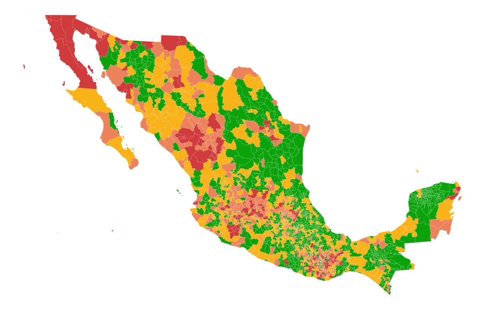
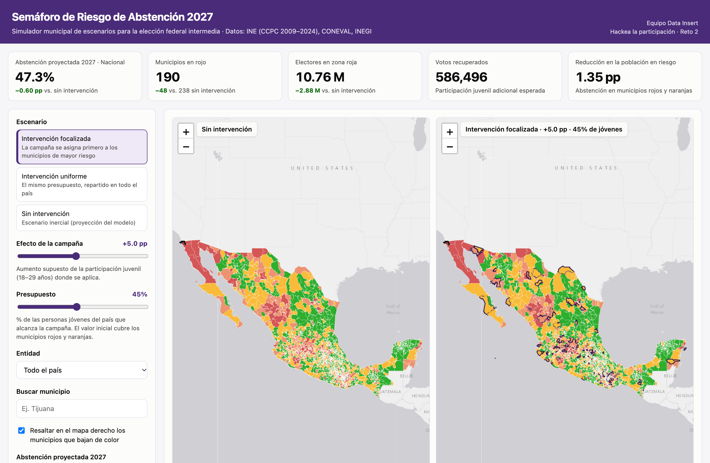
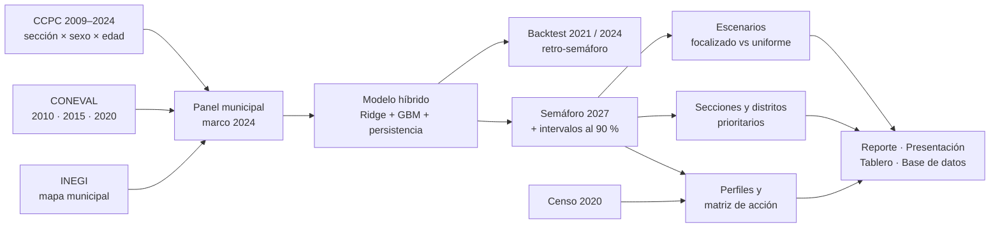

<div align="center">

# 🚦 Semáforo de Riesgo de Abstención 2027

**¿Dónde podría caer la participación en la elección intermedia de 2027, por qué, y qué puede hacer el INE al respecto?**

Equipo **Data Insert** · Hackathon INE *Hackea la participación: Datos que construyen democracia* · Reto 2: Predicción y escenarios de riesgo de abstención

[📄 Reporte](entregables/Reporte_metodologico_preventivo_DataInsert.pdf) · [📊 Presentación](entregables/Presentacion_ejecutiva_DataInsert.pdf) · [🗺️ Tablero interactivo](entregables/mapa_escenarios_2027.html) · [🗃️ Base de datos](entregables/base_datos/)

</div>

---

## En una frase

Con el mismo presupuesto, el INE puede **reducir 2.2 veces más la abstención de la población en riesgo** si decide dónde actuar con datos. Este repositorio construye el semáforo que le dice dónde, explica por qué hay riesgo en cada lugar y propone qué herramienta usar.

<p align="center">
  
  <br><sub>Semáforo 2027 sin intervención: abstención proyectada por municipio (verde &lt; 40 %, amarillo 40–50 %, naranja 50–58 %, rojo ≥ 58 %).</sub>
</p>

## Resultados clave

| | |
|---|---|
| 🔴 **238 municipios en rojo** | 13.6 millones de electores superarían 58 % de abstención en 2027 sin intervención (más 376 municipios en naranja). |
| 🏙️ **Dos perfiles de riesgo** | El 95 % de los electores en rojo vive en ciudades de alta movilidad (26 % nació en otra entidad, contra 17 % nacional). El resto son municipios de Oaxaca donde el 48 % habla una lengua indígena. |
| ✅ **Probado hacia atrás** | Con datos hasta 2018, el semáforo habría marcado en rojo o naranja al 70 % de los municipios con mayor abstención de 2021 (88 % en 2024). |
| 📉 **2.2× más efecto** | Con el mismo presupuesto, priorizar con el semáforo reduce 1.35 pp la abstención de la población en riesgo, contra 0.61 pp si se reparte parejo. |
| 📍 **Listo para operar** | Proyección para las 70,751 secciones y los 300 distritos federales. En el distrito típico, 48 de 218 secciones concentran la mitad de los jóvenes que se abstendrían. |

## El tablero

Un simulador en un solo archivo HTML que funciona sin internet. Tiene mapas sincronizados sin y con intervención, controles de efecto y presupuesto, una ficha por municipio con su historial y el porqué de su riesgo, y la lista de secciones prioritarias de cada Junta Distrital.

<p align="center">
  
</p>

> GitHub no ejecuta archivos HTML. Para usar el tablero, descarga [`entregables/mapa_escenarios_2027.html`](entregables/mapa_escenarios_2027.html) y ábrelo con doble clic en Chrome, Edge o Firefox.

## Cómo funciona



**Decisiones metodológicas clave**

1. **Municipios comparables en el tiempo.** El INE reasigna claves municipales entre elecciones, así que cada sección histórica se asigna al municipio al que pertenece en 2024. Se cubre más del 99.9 % de la lista nominal de cada año.
2. **Desviación intra-estatal.** El modelo predice la abstención de cada municipio *relativa a su entidad*. El nivel estatal de 2027 es un supuesto explícito: el de 2021, última intermedia, que también fue concurrente en las 32 entidades.
3. **Sin información del futuro.** Cada elección se predice solo con datos publicados antes de ella: rezagos electorales, la edición vigente del CONEVAL y la abstención de los municipios vecinos en elecciones previas.
4. **Validación honesta.** Backtest temporal, comparación contra reglas simples, análisis de robustez e intervalos conformales validados fuera de muestra.
5. **Métricas que no engañan.** Con un efecto lineal, la estrategia focalizada y la uniforme recuperan los mismos votos. Por eso se comparan por la reducción de abstención en la población en riesgo, no por cuántos votos se recuperan.

## Reproducir

```bash
python3 -m venv .venv
.venv/bin/pip install -r requirements.txt
./run_all.sh        # ~2 minutos; los PDF requieren LibreOffice
```

El pipeline es determinista: dos corridas producen resultados idénticos. `src/09_auditoria.py` verifica que las cifras clave coincidan entre reporte, presentación, base de datos y tablero.

<details>
<summary><b>Datos de entrada</b> (no incluidos en el repositorio por su tamaño, ~3.5 GB)</summary>

```
data/raw/ccpc/      CCPC 2009–2024 (DatosAbiertos_DECEyEC_ConteosCensales{año}/), INE
data/raw/coneval/   IRS_entidades_mpios_{2010,2015,2020}.xlsx, CONEVAL
data/raw/geo/       mun.shp, INEGI Marco Geoestadístico (división municipal)
data/raw/inegi/     iter2020/, INEGI Censo 2020 (Principales resultados por localidad)
```
</details>

<details>
<summary><b>Scripts</b></summary>

| Script | Qué hace |
|---|---|
| `src/01_ingest.py` | Lee los 192 archivos CCPC y los agrega por sección, sexo y grupo de edad. |
| `src/02_panel.py` | Proyecta las secciones al marco municipal 2024, cruza el CONEVAL y construye la vecindad municipal. |
| `src/02b_censo.py` | Indicadores del Censo 2020: migración, lengua indígena y escolaridad (diagnóstico, no modelo). |
| `src/03_model.py` | Variables sin fuga temporal, backtest, modelo híbrido, intervalos conformales y explicación por municipio. |
| `src/03b_robustez.py` | Compara cinco variantes del modelo. |
| `src/04_scenarios.py` | Proyección 2027, semáforo, escenarios, sensibilidad y curva de presupuesto. |
| `src/04b_retro.py` | Retro-semáforo: qué habría anticipado el procedimiento antes de 2021 y de 2024. |
| `src/04c_operativo.py` | Proyección por sección y distrito federal, secciones prioritarias y matriz de acción. |
| `src/05_export_figures.py` | Base de datos (CSV, y XLSX con diccionario) y figuras. |
| `src/06_maps.py` | Tablero HTML autocontenido y capas GeoJSON/GeoPackage. |
| `src/07_report.py` | Reporte metodológico (DOCX/PDF) generado desde los resultados. |
| `src/08_presentacion.py` | Presentación ejecutiva (PPTX/PDF). |
| `src/09_auditoria.py` | Auditoría de consistencia de cifras entre entregables. |
| `src/10_paquete.py` | LEEME y paquete de entrega. |
</details>

## Equipo

| | |
|---|---|
| Aldo Sebastian Altamirano Vázquez | [@SebastianAltamirano](https://github.com/SebastianAltamirano) |
| Carlo Kiliano Ferrera Guadarrama | [@CarloKiliano](https://github.com/CarloKiliano) |
| Isaac Pancardo Botello | [@botellopai18](https://github.com/botellopai18) |
| José Julián Pérez Bustamante | [@PBJulian](https://github.com/PBJulian) |

<sub>Datos públicos y agregados de INE, CONEVAL e INEGI; las bases no contienen información de personas identificables. Obra presentada al concurso *Hackea la participación* del Instituto Nacional Electoral.</sub>
